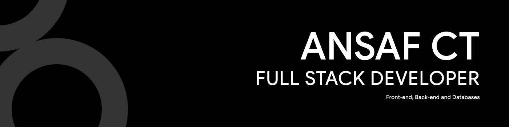

**Portfolio Website:** [ansafct.in](https://ansafct.in/)

I am a Full Stack Developer with over 4 years of experience building web applications[cite: 1]. My background covers both frontend and backend development, working primarily with Angular, Next.js, PHP (Laravel, Slim, CodeIgniter), and Python Django[cite: 1]. I focus on building functional, scalable applications[cite: 1].

---

### Technical Skills

| Category | Technologies |
| :--- | :--- |
| **Frontend** | Angular, Next.js, HTML, CSS, SCSS, Bootstrap, Tailwind, jQuery, Ajax, Wireframing[cite: 1] |
| **Backend** | PHP (Laravel, Slim, CodeIgniter), Python Django, WordPress Plugin Customization, Strapi, GraphQL, Pusher[cite: 1] |
| **Database & Cloud** | SQL, Firebase[cite: 1] |
| **DevOps & Tools** | Server Management, Deployment, CI/CD (GitHub), WordPress Deployment & Migration[cite: 1] |
| **Additional** | Vimeo Integration[cite: 1] |

---

### Contact

* **Portfolio:** [ansafct.in](https://ansafct.in/)
* **Location:** Malappuram, Kerala
* **Email:** ctansaf@gmail.com
* **LinkedIn:** [linkedin.com/in/ansaf-ct](https://www.linkedin.com/in/ansaf-ct)
